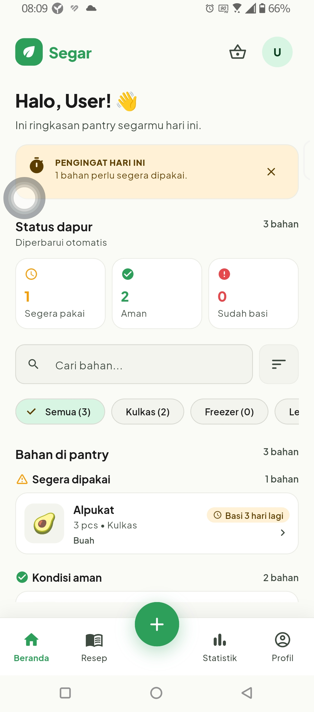
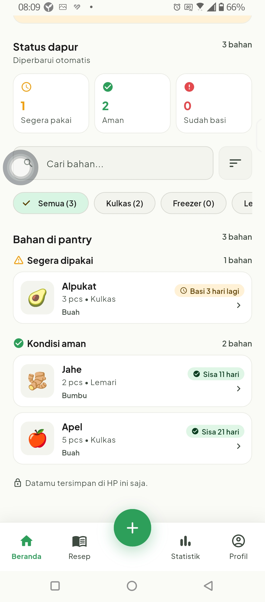

# Segar

Aplikasi pendamping dapur yang membantu kamu mencatat stok bahan, mengingatkan
sebelum bahan basi, dan menyarankan resep dari bahan yang paling perlu
diselamatkan.

Segar dibuat **offline-first**: semua data pantry, riwayat pemakaian, daftar
belanja, dan pengaturan tersimpan di perangkat lewat SQLite (Drift). Tidak ada
akun, login, Firebase, atau database online. Internet hanya dipakai untuk dua
fitur opsional yang bisa dimatikan kapan saja.

## Fitur

- **Onboarding** — perkenalan singkat dan pengisian nama panggilan.
- **Pantry** — tambah, ubah, cari, filter lokasi, dan urutkan bahan; status
  "Segera pakai", "Aman", dan "Sudah basi" dihitung otomatis.
- **Pengingat kedaluwarsa** — notifikasi lokal per bahan, dengan jam, ambang
  hari, dan jam tenang yang bisa diatur.
- **Resep lokal** — 12 resep Indonesia dengan skor kecocokan terhadap stok;
  memasak akan mengurangi stok dan bisa dibatalkan (undo).
- **Daftar belanja** — tambah manual, centang yang sudah dibeli, atau tarik
  bahan yang kurang dari sebuah resep.
- **Statistik** — penghematan, bahan terselamatkan, alasan pembuangan, dan tren
  pemakaian dalam bentuk grafik.
- **Cadangan lokal** — ekspor seluruh data ke file JSON dan pulihkan kembali.
- **Tema & aksesibilitas** — mode terang/gelap, teks Indonesia, dukungan font
  besar, dan orientasi potret.

### Fitur online (opsional)

| Fitur | Layanan | Data yang dikirim |
| --- | --- | --- |
| Cari produk lewat barcode | [Open Food Facts](https://world.openfoodfacts.org/) | Nomor barcode |
| Cari resep online | [TheMealDB](https://www.themealdb.com/) | Kata kunci pencarian |

Keduanya hanya berjalan saat kamu memintanya, bisa dimatikan di Pengaturan, dan
hasilnya di-cache di perangkat. Saat offline atau fitur dimatikan, Segar memakai
cache bila ada dan tetap berfungsi penuh tanpa internet.

## Tampilan Aplikasi

Klik gambar untuk membuka ukuran penuh.

<table>
  <tr>
    <td align="center" width="50%">
      <a href="segar_documentation/dashboard.jpeg">
        
      </a><br>
      <sub><b>Dashboard</b><br>Ringkasan status dapur dan pengingat hari ini.</sub>
    </td>
    <td align="center" width="50%">
      <a href="segar_documentation/dashboard2.jpeg">
        
      </a><br>
      <sub><b>Pantry</b><br>Daftar bahan, filter lokasi, dan status kedaluwarsa.</sub>
    </td>
  </tr>
  <tr>
    <td align="center" width="50%">
      <a href="segar_documentation/add%20bahan.jpeg">
        
      </a><br>
      <sub><b>Tambah bahan</b><br>Pindai barcode atau isi nama bahan secara manual.</sub>
    </td>
    <td align="center" width="50%">
      <a href="segar_documentation/add%20bahan%202.jpeg">
        
      </a><br>
      <sub><b>Detail bahan</b><br>Atur jumlah, lokasi, tanggal basi, dan pengingat.</sub>
    </td>
  </tr>
  <tr>
    <td align="center" colspan="2">
      <a href="segar_documentation/scan%20barcode%20pembelian.jpeg">
        
      </a><br>
      <sub><b>Cari lewat barcode</b><br>Ketik nomor barcode atau pindai kemasan.</sub>
    </td>
  </tr>
</table>

## Rencana Update

### Ekspor terjadwal harian (Excel/CSV) dan impor kembali

Fitur berikutnya yang direncanakan: Segar menjalankan **ekspor otomatis setiap
hari** ke file **Excel (`.xlsx`)** atau **CSV**, lalu file tersebut bisa
**diimpor kembali** ke aplikasi.

Rencana teknis:

- Penjadwalan harian di latar belakang (WorkManager di Android,
  BGTaskScheduler di iOS) dengan jam ekspor yang bisa dipilih.
- Format CSV untuk data ringan dan XLSX dengan beberapa sheet: pantry, riwayat
  pemakaian, dan daftar belanja.
- File disimpan ke folder yang dipilih pengguna atau dibagikan lewat share
  sheet. Tetap lokal, tanpa server.
- Riwayat ekspor beserta status berhasil/gagal, plus opsi membersihkan file
  lama.
- Impor kembali dengan validasi format/versi, pratinjau, dan pilihan mode
  **gabung** atau **ganti** data.
- Notifikasi lokal setelah ekspor selesai atau gagal.
- Pengaturan: aktif/nonaktif, jam ekspor, format file, dan folder tujuan.

Status: **direncanakan**, belum diimplementasikan. Untuk saat ini, ekspor JSON
manual tetap tersedia di **Pengaturan → Cadangan & pemulihan**.

| Kemampuan | Status |
| --- | --- |
| Ekspor/impor JSON manual | Selesai |
| Ekspor terjadwal harian ke CSV/XLSX | Direncanakan |
| Impor kembali CSV/XLSX | Direncanakan |

## Arsitektur

Alur data satu arah:

```
Widget → Provider (Riverpod) → Repository → DAO (Drift) → SQLite
```

- UI tidak pernah mengakses database atau jaringan secara langsung.
- Repository adalah satu-satunya gateway data dan mengembalikan model tampilan
  (`PantryItemView`, `RecipeView`, `ShoppingListEntry`, dst.).
- Logika murni (filter, skor resep, statistik, penjadwalan notifikasi) dipisah
  ke `lib/core/utils/` agar mudah diuji tanpa Flutter binding.
- Semua teks UI berasal dari ARB `lib/l10n/app_id.arb`; tidak ada string
  hardcoded di widget.

```
lib/
├── app.dart                 # MaterialApp.router, tema, locale
├── core/                    # tema, router, notifikasi, util, widget bersama
├── data/
│   ├── local/               # tabel Drift, DAO, database, seed loader
│   ├── remote/              # klien Open Food Facts & TheMealDB (Dio)
│   ├── repositories/        # gateway data
│   ├── backup/              # model & repository cadangan lokal
│   └── models/              # model tampilan
├── features/                # layar per fitur
└── l10n/                    # ARB + hasil generate
```

## Menjalankan

Prasyarat: Flutter 3.47+ (Dart 3.13+), Android SDK, dan/atau Xcode.

```bash
flutter pub get
flutter gen-l10n
flutter run
```

Aset seed (katalog bahan dan resep) dimuat otomatis saat pertama kali aplikasi
dibuka. Data pengguna tidak pernah keluar dari perangkat kecuali kamu memilih
untuk membagikan file cadangan.

## Build

```bash
# Debug
flutter build apk --debug

# Release
flutter build apk --release
```

Build release saat ini memakai debug signing key agar bisa dipasang langsung
untuk pengujian. Ganti `signingConfig` di `android/app/build.gradle.kts` dengan
keystore produksi sebelum mengunggah ke Play Store. Untuk iOS:

```bash
flutter build ios --release
```

## Cadangan

Ekspor menghasilkan file `segar-backup-YYYY-MM-DD.json` dengan format:

```json
{
  "format": "segar-backup",
  "version": 1,
  "appVersion": "1.0.0",
  "exportedAt": "2026-11-10T09:30:00.000",
  "pantryItems": [],
  "usageLogs": [],
  "shoppingList": [],
  "settings": {}
}
```

- `format` dan `version` divalidasi saat impor; file asing atau versi yang lebih
  baru akan ditolak.
- Restore **mengganti** seluruh data pengguna, lalu menerapkan pengaturan yang
  tersimpan di file.
- Tanggal cadangan terakhir disimpan di preferensi lokal.

## Pengujian

```bash
flutter analyze
flutter test
```

Test mencakup logika murni, DAO dan repository (database in-memory), parser
jaringan, serta widget test untuk layar utama, onboarding, resep, statistik,
barcode, daftar belanja, dan cadangan. Matriks uji responsif mencakup 6 ukuran
perangkat × 5 skala teks (hingga 200%) dan memastikan tidak ada overflow.

## Rilis

Materi untuk publikasi ada di [`docs/rilis/`](docs/rilis/README.md):

- [Kebijakan privasi](docs/rilis/privacy-policy.md) — sumber Markdown
- [Kebijakan privasi (HTML)](docs/rilis/privacy-policy.html) — siap di-hosting
- [Data safety & App Privacy](docs/rilis/data-safety.md)
- [Store listing](docs/rilis/store-listing.md)
- [Checklist aset](docs/rilis/assets-checklist.md)
- [Checklist rilis](docs/rilis/release-checklist.md)

Ringkasan langkah sebelum publikasi: ganti `applicationId`/bundle ID
`com.example.segar`, buat keystore produksi, build AAB
(`flutter build appbundle --release`), jalankan QA di perangkat nyata, lalu isi
listing dan Data safety. Status lengkap ada di checklist rilis.

## Izin platform

- Android: `INTERNET`, `CAMERA`, `POST_NOTIFICATIONS`,
  `RECEIVE_BOOT_COMPLETED`, `VIBRATE`.
- iOS: deskripsi penggunaan kamera dan pustaka foto.

Kamera hanya dipakai saat kamu membuka pemindai barcode. Notifikasi bersifat
lokal dan dijadwalkan oleh perangkat.

## Lisensi

Proyek pribadi. Aset gambar dan font Plus Jakarta Sans dipakai untuk keperluan
aplikasi ini.
